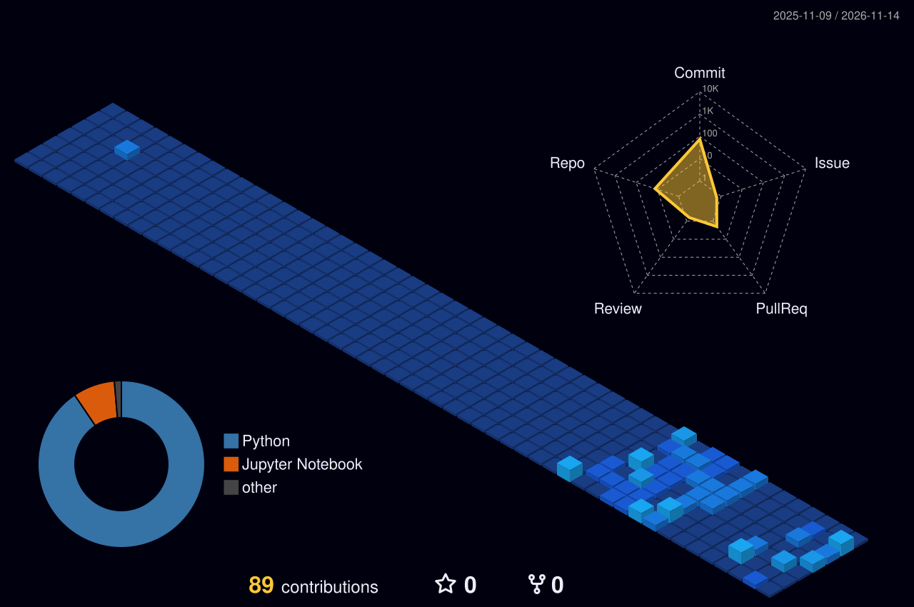

# Hi! I am K Vasista Kumar Reddy

### Data Analyst | SQL · Python · Power BI · dbt | Turning raw data into business decisions

---

##  Ａｂｏｕｔ Ｍｅ 

I'm a B.Tech CSE (AI/ML) graduate who builds **end-to-end analytics projects**: data in a MySQL warehouse, modeled with dbt, and delivered as Power BI dashboards that business teams can act on. My focus is clean data, clear KPIs, and decisions people can trust.

- **Data & SQL**: MySQL warehouse design, SQL transformations, dbt staging → fact models
- **BI & dashboards**: Power BI with DAX (`CALCULATE`, `FILTER`, What-If parameters)
- **Python**: generating and shaping datasets for analysis
- **Business focus**: fraud monitoring, churn risk and revenue recovery KPIs
- **Training**: Data Analyst course at ExcelR, plus IBM and CFI certifications
- **Foundation**: C programming and a CSE (AI/ML) degree from Alliance University

I enjoy building analytics that end in a clear decision, and learning in public.

[Resume](https://drive.google.com/file/d/1PJPA53MRh3eAxh_T8EJbgQ8r9k3uDkzW/view?usp=sharing) · [LinkedIn](https://www.linkedin.com/in/vasistakumar/) · [GitHub](https://github.com/KalamallaVasista) · [Email](mailto:kalamallavasi@gmail.com)

---

### ⚡ At a Glance

| | |
|---|---|
| 🎯 **Target role** | Data Analyst / BI Analyst / Business Analyst |
| 🧰 **Core stack** | SQL · MySQL · Python · dbt · Power BI (DAX) |
| 🎓 **Education** | B.Tech CSE (AI/ML), Alliance University, 2022–2026, CGPA 9.0 |
| 📜 **Training** | Data Analyst course, ExcelR |
| 📍 **Location** | Bangalore, India |
| 📬 **Contact** | kalamallavasi@gmail.com |

### 🚀 Featured Projects

| Project | Problem | What I Built | Tools |
|---|---|---|---|
| [**B2B Payment Fraud & Chargeback Command Center**](https://github.com/KalamallaVasista/B2B-Fraud-Risk-Engine) | Fraud rules block good customers while fraud still costs money | 50,000 synthetic B2B transactions with fraud flags and AI risk scores in a MySQL warehouse; dbt models (`stg_transactions` → `fct_fraud_monitoring`); Power BI dashboard with a **What-If risk threshold** in DAX showing **Revenue Lost** vs **False Positive Rate**, plus a Customer Recovery Queue | Python · MySQL · dbt · Power BI · DAX |
| [**Revenue Recovery & Churn Risk Engine**](https://github.com/KalamallaVasista/Revenue-Recovery-Engine) | Retention teams learn about at-risk customers too late | Rule-based churn risk score in SQL/dbt (drops in transaction volume, later-than-usual invoice payments), customer dimension and payment-history fact; Power BI dashboard segmenting customers by risk with a daily **Risk Roster** | SQL · dbt · Power BI |

> Both projects use synthetic data engineered to mimic a B2B SaaS environment. The churn score is rule-based, not a predictive ML model.

### 🎓 Certifications

| Certificate | Issuer | Verify |
|---|---|---|
| Power BI Fundamentals | Corporate Finance Institute (Coursera), Apr 2025 | [Verify](https://coursera.org/verify/E86CZLBA7KC0) |
| Business Intelligence (BI) Essentials | IBM (Coursera), Apr 2025 | [Verify](https://coursera.org/verify/9DSL6Z9RXMUA) |
| Machine Learning with Python | IBM (Coursera) | [Verify](https://coursera.org/verify/HQLLMW82ULW8) |
| Data Analyst Course | ExcelR | — |

---

### 🚀 Languages - Frameworks - Tools - Workspace 🚀

  

  
  
  
  

## 📌 Pinned Projects

  
  

## 📊 My GitHub Stats

⏳ 𝚃𝚑𝚊𝚗𝚔𝚜 𝚏𝚘𝚛 𝚜𝚝𝚊𝚢𝚒𝚗𝚐 𝚘𝚗 𝚖𝚢 𝚙𝚛𝚘𝚏𝚒𝚕𝚎 ◔_◔ ⌛

<table align="center">
  <tr>
    <td align="center"> ⌚ Dashboards (Power BI)</td>
    <td align="center"> ⚙️ Pipelines (SQL + dbt)</td>
  </tr>
</table>

